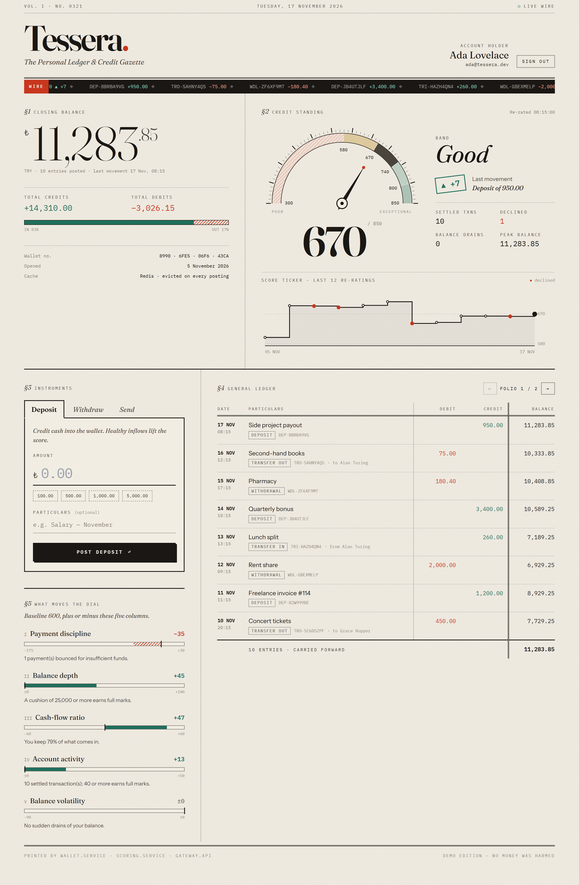
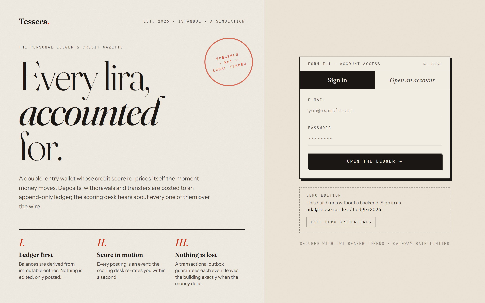
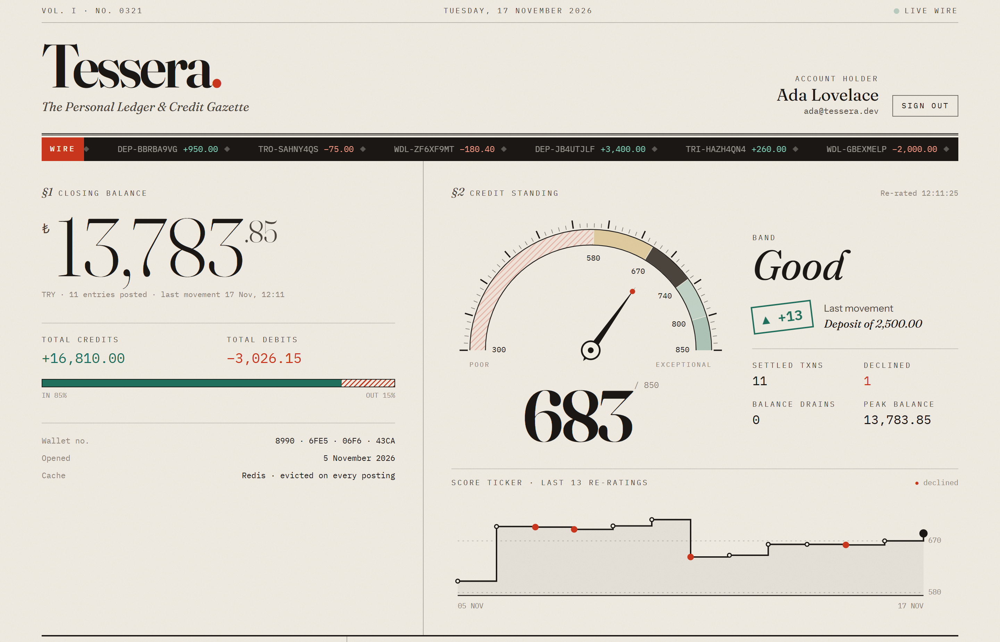
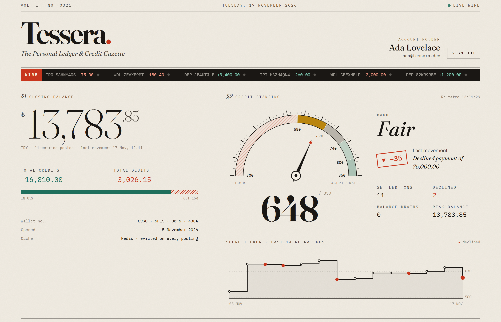
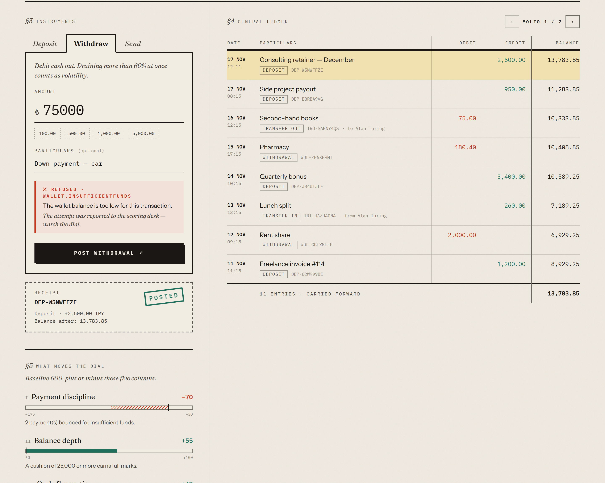
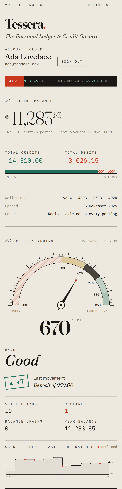
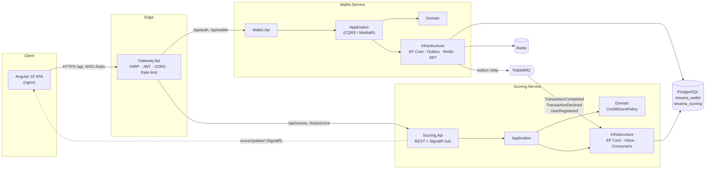
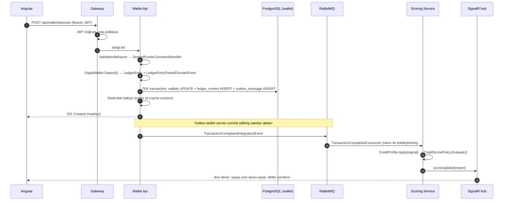

<div align="center">

# Tessera.

**Sanal Cüzdan ve Kredi Skorlama Simülatörü**

.NET 8 mikroservisleri · Clean Architecture · DDD · CQRS · RabbitMQ/MassTransit · PostgreSQL · Redis · Angular 19

</div>



Tessera, çift taraflı kayıt (double-entry) mantığıyla çalışan bir sanal cüzdan ile bu cüzdandaki her para hareketini olay olarak dinleyip kredi skorunu anlık yeniden hesaplayan bir skorlama servisinden oluşur. Para yatırdığınızda, çektiğinizde ya da birine gönderdiğinizde işlem önce defter-i kebire işlenir, ardından RabbitMQ üzerinden skorlama masasına ulaşır ve yeni skor SignalR ile ekranınızdaki kadranın ibresini oynatır. Bakiyeniz yetmediği için reddedilen bir ödeme bile bir sinyaldir; skorunuz bunu da hesaba katar.

Proje bir portfolyo çalışmasıdır: amaç, gerçek bir finans ürününde karşılaşılacak mimari kararları (tutarlılık sınırları, güvenilir mesajlaşma, idempotent tüketiciler, önbellek geçersizleştirme, kenar güvenliği) küçük ama eksiksiz bir sistem üzerinde göstermektir. Para birimi ve skor tamamen hayalidir.

---

## İçindekiler

1. [Ekran görüntüleri](#ekran-görüntüleri)
2. [Mimari](#mimari)
3. [Bir işlemin yolculuğu](#bir-işlemin-yolculuğu)
4. [Servisler ve katmanlar](#servisler-ve-katmanlar)
5. [Skor modeli](#skor-modeli)
6. [Docker Compose ile çalıştırma](#docker-compose-ile-çalıştırma)
7. [Backend'i yerelde geliştirme](#backendi-yerelde-geliştirme)
8. [Frontend'i çalıştırma](#frontendi-çalıştırma)
9. [API referansı](#api-referansı)
10. [Testler](#testler)
11. [Tasarım kararları](#tasarım-kararları)
12. [Sorun giderme](#sorun-giderme)

---

## Ekran görüntüleri

Arayüz bilinçli olarak alışılmış "koyu tema + mor gradyan" SaaS panellerinden uzak tutuldu. Görsel dil bir **gazete sayfası ile muhasebe defterinin** karışımı: krem rengi kâğıt dokusu, Fraunces serif manşetler, IBM Plex Mono rakamlar, kart yerine çizgiler (rule), borç kayıtları için kırmızı mürekkep, alacaklar için yeşil. Kredi skoru bir analog ölçü aleti gibi çizildi; yeni skor geldiğinde ibre yaylanarak yerine oturur.

| Giriş — "Form T-1" imza kartı | Canlı yeniden derecelendirme |
|---|---|
|  |  |

| Reddedilen ödeme: skor −35 | Enstrümanlar ve defter-i kebir |
|---|---|
|  |  |

<p align="center"></p>

> Görüntüler, frontend'in **demo modunda** (backend gerektirmeyen çevrimdışı derleme) Edge headless ile gerçek tıklamalar yapılarak alınmıştır. Ayrıntılar için [Demo modu](#demo-modu-backend-olmadan).

---

## Mimari



**Temel ilkeler**

- **Her servis kendi verisinin sahibidir.** Wallet ve Scoring aynı PostgreSQL sunucusunu paylaşsa da ayrı veritabanları (`tessera_wallet`, `tessera_scoring`) ve şemalar kullanır; birbirlerinin tablolarına asla dokunmazlar.
- **Servisler arası iletişim asenkrondur.** Scoring, Wallet'ı HTTP ile çağırmaz; yalnızca yayımlanan entegrasyon olaylarını (`Tessera.Contracts`) dinler. Wallet kapalıyken Scoring çalışmaya devam eder, tersi de geçerlidir.
- **Bağımlılıklar içe doğru akar.** Domain hiçbir altyapı paketini tanımaz; Application yalnızca arayüzleri (port) bilir; EF Core, MassTransit, Redis ve JWT ayrıntıları Infrastructure'da kalır.

---

## Bir işlemin yolculuğu

Kullanıcı 2.500 ₺ yatırdığında olanlar:



Kritik nokta 7. adım: iş verisi ve giden mesaj **aynı veritabanı işleminde** yazılır (Transactional Outbox). Böylece "para kaydedildi ama olay kayboldu" ya da "olay gitti ama işlem geri alındı" durumları oluşamaz. Karşı tarafta MassTransit Inbox aynı mesajın iki kez işlenmesini engeller; mesajlaşma en-az-bir-kez (at-least-once) olsa da skor etkisi tam-bir-kez olur.

---

## Servisler ve katmanlar

```
tessera/
├─ src/
│  ├─ BuildingBlocks/
│  │  ├─ Tessera.SharedKernel     # Entity, AggregateRoot, DomainEvent, Result/Error
│  │  ├─ Tessera.Application      # ICommand/IQuery, Validation & Logging pipeline behavior'ları
│  │  ├─ Tessera.Contracts        # Servisler arası entegrasyon olayları (yayımlanmış dil)
│  │  ├─ Tessera.Security         # JWT seçenekleri, ortak doğrulama kaydı, claim yardımcıları
│  │  └─ Tessera.AspNetCore       # Result → ProblemDetails, global exception handler, Swagger
│  ├─ Services/
│  │  ├─ Wallet.Service/
│  │  │  ├─ Wallet.Domain         # UserAccount, DigitalWallet, LedgerEntry, Money, TransferService
│  │  │  ├─ Wallet.Application    # Register/Login, Deposit/Withdraw/Transfer, sorgular, cache behavior
│  │  │  ├─ Wallet.Infrastructure # EF Core, migration'lar, outbox, Redis, PBKDF2, JWT üretimi
│  │  │  └─ Wallet.Api            # Minimal API uç noktaları
│  │  └─ Scoring.Service/
│  │     ├─ Scoring.Domain        # CreditProfile, ScoreSnapshot, CreditScorePolicy
│  │     ├─ Scoring.Application   # OpenCreditProfile, RecordTransactionSignal, GetCreditReport
│  │     ├─ Scoring.Infrastructure# EF Core, inbox, MassTransit tüketicileri
│  │     └─ Scoring.Api           # REST + SignalR ScoreHub
│  └─ Gateway/Gateway.Api         # YARP ters vekil, JWT, CORS, rate limiting
├─ tests/
│  ├─ Wallet.Domain.Tests
│  └─ Scoring.Domain.Tests
├─ frontend/tessera-web/          # Angular 19 (standalone, signals, Tailwind CSS)
├─ docs/screenshots/
└─ docker-compose.yml
```

### Wallet.Service

| Katman | Sorumluluk |
|---|---|
| **Domain** | `DigitalWallet` aggregate'i bakiyenin tek kapısıdır: her değişiklik tam olarak bir `LedgerEntry` üretir ve `Balance = Σ alacak − Σ borç` değişmezi korunur. Kayıtlar yalnızca eklenir (append-only), düzeltme bile yeni kayıttır. `Money` value object'i sıfır/negatif tutarı, ikiden fazla ondalığı ve 250.000 üst sınırını reddeder. İki aggregate'e yayılan transfer, bir domain servisi (`TransferService`) olarak modellenmiştir; iki bacak ortak bir `CorrelationId` taşır. |
| **Application** | Her kullanım senaryosu bir komut veya sorgudur (MediatR). Pipeline sırası: **Logging → Validation (FluentValidation) → QueryCaching → Handler**. İş hataları istisna ile değil `Result<T>` ile döner. Domain olayları, entegrasyon olaylarına burada çevrilir. |
| **Infrastructure** | `WalletDbContext`, `SaveChangesAsync` içinde domain olaylarını **commit'ten önce** yayımlar; handler'lar MassTransit üzerinden yayın yapar, bu yayın outbox tablosuna aynı transaction'da düşer. PostgreSQL `xmin` sistem sütunu iyimser eşzamanlılık belirteci olarak kullanılır. Parolalar ASP.NET Core Identity'nin PBKDF2 hasher'ı ile saklanır. |
| **Api** | İnce Minimal API uç noktaları; kimlik `sub` claim'inden okunur, kullanıcıdan asla gövdede alınmaz. |

**Okuma tarafı (CQRS):** Sorgular aggregate yüklemez; `IWalletReadModel` doğrudan `AsNoTracking` projeksiyonlarıyla DTO üretir. Bakiye özeti Redis'te cache-aside olarak tutulur ve her başarılı yazma işleminden sonra ilgili kullanıcı(lar) için silinir. Redis erişilemezse sistem durmaz, yalnızca veritabanına düşer.

### Scoring.Service

`CreditProfile` ham işlemleri değil, skoru açıklamaya yetecek **birikimli göstergeleri** tutar (toplam giriş/çıkış, son bakiye, işlem sayısı, reddedilen ödeme sayısı, ani bakiye boşaltma sayısı) ve son 60 skor değişikliğini gerekçesiyle saklar. Tüketiciler yalnızca adaptördür: `Tessera.Contracts` olaylarını Scoring'in kendi diline (`TransactionSignal`) çevirip komut gönderirler — bu, bağlamlar arası bir **anti-corruption** katmanıdır. Olaylar sıra dışı gelirse (örneğin `TransactionCompleted`, `UserRegistered`'dan önce) profil ilk görüldüğü anda açılır.

### Gateway.Api

Tek dış giriş noktası. YARP rotaları yapılandırmadan okunur ve rota başına yetkilendirme politikası taşır:

| Rota | Hedef | Politika |
|---|---|---|
| `/api/auth/**` | Wallet | anonim + IP başına dakikada 10 istek (brute-force koruması) |
| `/api/wallet/**` | Wallet | kimlik doğrulanmış |
| `/api/scores/**` | Scoring | kimlik doğrulanmış |
| `/hubs/**` | Scoring (WebSocket) | kimlik doğrulanmış, token `access_token` sorgu parametresinden |

JWT hem gateway'de (geçersiz istek içeri hiç girmesin) hem de servislerde (ağ içinde de örtük güven olmasın) doğrulanır — **derinlemesine savunma**.

---

## Skor modeli

Gerçek bir kredi bürosu algoritması değil; açıklanabilir ve deterministik bir simülasyon. Kaynak: [`CreditScorePolicy.cs`](src/Services/Scoring.Service/Scoring.Domain/Policies/CreditScorePolicy.cs)

```
skor = 600 (taban)
     + Ödeme disiplini     [-175 … +30]   reddedilen her ödeme −35; hiç ret yoksa ve ≥5 işlem varsa +30
     + Bakiye derinliği    [   0 … +100]  25.000 ₺ ve üzeri tam puan
     + Nakit akışı oranı   [ -60 … +60]   (giriş − çıkış) / giriş
     + Hesap hareketliliği [   0 … +50]   40 işlemde tam puan
     + Bakiye oynaklığı    [ -90 … 0]     bakiyenin %60'ından fazlasını tek seferde çeken her çıkış −15
→ 300 … 850 aralığına sıkıştırılır
```

| Bant | Aralık |
|---|---|
| Poor | 300 – 579 |
| Fair | 580 – 669 |
| Good | 670 – 739 |
| Very good | 740 – 799 |
| Exceptional | 800 – 850 |

Her faktör katkısıyla birlikte API'den döner; arayüzdeki "What moves the dial" bölümü bu yüzden skorun neden değiştiğini satır satır gösterebilir.

---

## Docker Compose ile çalıştırma

Tüm sistemi (PostgreSQL, Redis, RabbitMQ, üç .NET servisi ve nginx arkasındaki Angular uygulaması) tek komutla kaldırabilirsiniz.

**Gereksinimler:** Docker Desktop (veya Docker Engine + Compose v2), boşta 5000, 5101, 5102, 5432, 5672, 6379, 8080 ve 15672 portları.

```bash
git clone <repo-url> tessera
cd tessera

# İsteğe bağlı: varsayılan parolaları ve JWT anahtarını değiştirin
cp .env.example .env

docker compose up --build -d
docker compose ps
```

İlk açılışta servisler veritabanlarını ve şemaları EF Core migration'larıyla kendileri oluşturur (`Database:MigrateOnStartup`). Altyapı konteynerleri sağlıklı (healthy) olmadan .NET servisleri başlatılmaz.

| Adres | Ne var? |
|---|---|
| http://localhost:8080 | **Uygulama** (nginx; `/api` ve `/hubs` aynı origin üzerinden gateway'e aktarılır) |
| http://localhost:5000 | Gateway.Api |
| http://localhost:5101/swagger | Wallet.Api Swagger |
| http://localhost:5102/swagger | Scoring.Api Swagger |
| http://localhost:15672 | RabbitMQ yönetim paneli (`tessera` / `tessera`) |

**Kendi kendine test senaryosu:**

1. http://localhost:8080 adresinde "Open an account" ile iki hesap açın (ör. `ada@example.com` ve `grace@example.com`).
2. İlk hesapla 10.000 yatırın; birkaç yüz milisaniye içinde kadranın hareket ettiğini görün.
3. Bakiyenizden fazla bir tutar çekmeyi deneyin: işlem reddedilir, fakat `TransactionDeclinedIntegrationEvent` yine yayımlanır ve skor düşer.
4. İkinci hesabın e-postasına para gönderin; ikinci hesabı başka bir tarayıcıda açık tutarsanız gelen transferin sayfa yenilemeden deftere düştüğünü görürsünüz (skor itmesi defteri de tazeler).
5. RabbitMQ panelinde `transaction-completed` kuyruğunu, PostgreSQL'de `wallet.outbox_message` ve `scoring.inbox_state` tablolarını inceleyin.

Durdurmak ve verileri silmek için:

```bash
docker compose down -v
```

---

## Backend'i yerelde geliştirme

Servisleri IDE'den çalıştırıp yalnızca altyapıyı Docker'da tutmak en verimli geliştirme döngüsüdür.

**Gereksinimler:** .NET 8 SDK (daha yeni bir SDK da `net8.0` hedefini derler), Docker.

```bash
# 1) Yalnızca altyapı
docker compose up -d postgres redis rabbitmq

# 2) Araçlar ve derleme
dotnet tool restore          # dotnet-ef 8.0.11 (yerel araç manifesti)
dotnet build Tessera.sln

# 3) Üç ayrı terminalde
dotnet run --project src/Services/Wallet.Service/Wallet.Api     # http://localhost:5101
dotnet run --project src/Services/Scoring.Service/Scoring.Api   # http://localhost:5102
dotnet run --project src/Gateway/Gateway.Api                    # http://localhost:5000
```

`appsettings.json` dosyaları bu senaryoya göre (`localhost`, kullanıcı/parola `tessera`) hazırdır. JWT imzalama anahtarı yalnızca geliştirme amaçlıdır; gerçek ortamda `Jwt__SigningKey` ortam değişkeni ya da bir secret store ile verilmelidir. Üç servisin **aynı** anahtarı, issuer'ı ve audience'ı kullanması zorunludur.

**Migration işlemleri**

```bash
# Yeni migration (Wallet)
dotnet ef migrations add <Ad> \
  -p src/Services/Wallet.Service/Wallet.Infrastructure \
  -s src/Services/Wallet.Service/Wallet.Api \
  -o Persistence/Migrations

# Yeni migration (Scoring)
dotnet ef migrations add <Ad> \
  -p src/Services/Scoring.Service/Scoring.Infrastructure \
  -s src/Services/Scoring.Service/Scoring.Api \
  -o Persistence/Migrations

# Üretim için idempotent SQL betiği
dotnet ef migrations script --idempotent -p src/Services/Wallet.Service/Wallet.Infrastructure -s src/Services/Wallet.Service/Wallet.Api
```

Üretim ortamında açılışta migration yerine betik uygulamayı tercih ediyorsanız `Database__MigrateOnStartup=false` verin.

---

## Frontend'i çalıştırma

**Gereksinimler:** Node.js 20 veya 22 LTS, npm.

```bash
cd frontend/tessera-web
npm install
npm start            # ng serve → http://localhost:4200
```

Geliştirme yapılandırması (`environment.development.ts`) API'yi doğrudan `http://localhost:5000` adresinden çağırır; yani bu modda tarayıcı gateway ile **cross-origin** konuşur ve gateway'in CORS politikası devreye girer. Production derlemesinde (`npm run build`) taban URL boştur; uygulama nginx arkasında aynı origin'den `/api` ve `/hubs` yollarını kullanır.

### Demo modu (backend olmadan)

```bash
npm run start:demo   # veya: npm run build:demo
```

Demo derlemesinde bir HTTP interceptor gateway'i tarayıcı içinde taklit eder: kayıt, giriş, para yatırma/çekme/transfer, reddedilen ödemeler ve gecikmeli skor güncellemeleri sunucudaki kurallarla aynı şekilde çalışır (skor politikası birebir TypeScript'e taşınmıştır). Önceden doldurulmuş hesap: `ada@tessera.dev` / `Ledger2026`. Transfer için `grace@tessera.dev` ve `alan@tessera.dev` alıcıları hazırdır. Demo interceptor'ı JWT ve hata interceptor'larının *arkasına* yerleştirildiğinden, bu katmanlar gerçek backend'deki gibi çalışır.

### Frontend mimarisi

- **Standalone bileşenler, signals ve yeni kontrol akışı** (`@if`, `@for`); NgModule yok. Rotalar lazy-load edilir ve `canMatch` guard'larıyla korunur.
- **Reactive forms:** giriş/kayıt ve üç işlem formu; sunucudan gelen alan doğrulama hataları (`ProblemDetails.errors`) ilgili form kontrolüne eşlenir.
- **Interceptor zinciri:** `authInterceptor` token'ı yalnızca kendi API'mize ekler (üçüncü taraf origin'lere sızdırmaz) → `errorInterceptor` her hatayı tek tip `ApiError`'a dönüştürür; 401'de oturumu kapatıp girişe yönlendirir, ağ/5xx/429 hatalarında genel bildirim gösterir, 4xx'i forma bırakır.
- **Oturum:** `SessionStore` (signal tabanlı) token'ı saklar ve süresi dolduğu anda otomatik çıkış planlar.
- **Gerçek zaman:** `ScoreStreamService`, `@microsoft/signalr` ile otomatik yeniden bağlanan bir hub bağlantısı kurar; bağlantı durumu manşetteki "LIVE WIRE" göstergesine yansır.
- **Durum:** `DashboardStore` sayfa kapsamlı bir servistir; skor itmesi geldiğinde bakiye ve defter de tazelenir, böylece başkasından gelen transferler polling olmadan görünür.
- **Stil:** Tailwind CSS ve özel bir tasarım belirteci seti (`paper`, `ink`, `vermilion`, `verdigris`, `ochre`); kadran ve skor geçmişi kütüphanesiz, elle yazılmış SVG'dir.

---

## API referansı

Tüm uç noktalar gateway üzerinden (`http://localhost:5000`) erişilebilir. Hatalar RFC 9457 `application/problem+json` formatında, makine tarafından okunabilir bir `code` alanıyla döner.

| Metot | Yol | Açıklama | Başarılı | Olası hatalar |
|---|---|---|---|---|
| POST | `/api/auth/register` | Hesap + cüzdan açar, JWT döner | 201 | 400, 409 |
| POST | `/api/auth/login` | JWT döner | 200 | 401, 429 |
| GET | `/api/wallet` | Bakiye özeti (Redis'ten) | 200 | 401, 404 |
| GET | `/api/wallet/ledger?page=1&pageSize=10` | Sayfalı defter | 200 | 400, 401 |
| POST | `/api/wallet/deposits` | `{ amount, description? }` | 201 | 400, 422 |
| POST | `/api/wallet/withdrawals` | `{ amount, description? }` | 201 | 400, 422 `Wallet.InsufficientFunds` |
| POST | `/api/wallet/transfers` | `{ recipientEmail, amount, note? }` | 201 | 404 `Wallet.RecipientNotFound`, 422 |
| GET | `/api/scores/me` | Skor, bant, faktörler, geçmiş | 200 | 401 |
| WS | `/hubs/score` | `scoreUpdated` olayını iter | — | 401 |

Örnek:

```bash
TOKEN=$(curl -s -X POST http://localhost:5000/api/auth/register \
  -H "Content-Type: application/json" \
  -d '{"email":"ada@example.com","fullName":"Ada Lovelace","password":"Ledger2026"}' | jq -r .accessToken)

curl -s -X POST http://localhost:5000/api/wallet/deposits \
  -H "Authorization: Bearer $TOKEN" -H "Content-Type: application/json" \
  -d '{"amount":2500,"description":"Consulting retainer"}'

sleep 1 && curl -s http://localhost:5000/api/scores/me -H "Authorization: Bearer $TOKEN" | jq '.score, .band, .lastReason'
```

---

## Testler

```bash
dotnet test Tessera.sln
```

Domain katmanı altyapıdan tamamen bağımsız olduğu için testler saniyenin altında çalışır. Kapsanan kurallar arasında: bakiye = alacaklar − borçlar değişmezi, yetersiz bakiyede durumun hiç değişmemesi, transferin iki bacağının ortak korelasyon kimliği, kendine transferin reddi, `Money` sınır değerleri, skorun 300–850 aralığında kalması, reddedilen ödemenin skoru düşürmesi, ani bakiye boşaltma tespiti, skor geçmişinin sınırlandırılması ve faktör puanlarının toplamının skora eşitliği bulunur.

---

## Tasarım kararları

**Neden Transactional Outbox?** Bir veritabanına yazıp ardından RabbitMQ'ya yayın yapmak iki ayrı sistemde "ikili yazma" (dual write) demektir; arada bir çökme olursa ya olay kaybolur ya da gerçekleşmemiş bir işlem için olay gider. MassTransit EF Core Outbox, mesajı iş verisiyle aynı transaction'da `outbox_message` tablosuna yazar; arka plandaki teslim servisi commit edilmiş satırları kuyruğa aktarır.

**Neden Inbox?** Outbox en-az-bir-kez teslim garantisi verir; aynı mesaj iki kez gelebilir. Scoring tarafındaki `inbox_state` tablosu mesaj kimliğine göre tekilleştirme yapar, böylece bir para yatırma skoru iki kez etkilemez.

**Neden aggregate geçmiş kayıtları yüklemiyor?** `DigitalWallet` yalnızca bakiyesine ihtiyaç duyar. Binlerce defter satırını her yazmada belleğe almak yerine aggregate yalnızca o iş biriminde eklenen kayıtları tutar; geçmiş, sorgu tarafında okunur. Eşzamanlı yazmalar `xmin` belirteci ile yakalanır ve 409 olarak döner.

**Neden reddedilen işlem de bir olay?** Kredi değerlendirmesinde karşılıksız kalan ödeme girişimleri en güçlü olumsuz sinyallerdendir. Bu yüzden yetersiz bakiye durumunda aggregate değişmez ama `TransactionDeclinedIntegrationEvent` yine outbox üzerinden güvenle yayımlanır.

**Neden `Result<T>`?** "Bakiye yetersiz" bir istisna değil, beklenen bir iş sonucudur. Hatalar tiplendirilmiş (`Validation`, `NotFound`, `Conflict`, `BusinessRule` …) değerler olarak akar ve API katmanında tek bir yerde HTTP durum kodlarına eşlenir.

**Neden JWT'yi Wallet üretiyor?** Kullanıcı hesapları Wallet bağlamının sorumluluğunda. Daha büyük bir sistemde bu görev ayrı bir kimlik servisine (ör. Duende IdentityServer, Keycloak) ve asimetrik imzaya taşınmalıdır; `Tessera.Security` yapı taşı bu geçişi tek noktadan yapılabilir kılar.

**Bilinçli olarak kapsam dışı bırakılanlar:** dağıtık izleme (OpenTelemetry), refresh token akışı, servis başına ayrı veritabanı sunucusu, entegrasyon testleri (Testcontainers). Hepsi mevcut yapıya eklenebilecek şekilde yer bırakılarak tasarlandı.

---

## Sorun giderme

| Belirti | Olası neden / çözüm |
|---|---|
| Servis açılışta `Jwt` doğrulama hatası veriyor | `Jwt:SigningKey` en az 32 karakter olmalı ve üç serviste aynı olmalı. |
| Skor kadranı hareket etmiyor, manşette "WIRE DOWN" | SignalR bağlantısı kurulamadı. Gateway'in çalıştığını ve `/hubs` isteğinin proxy'den geçtiğini kontrol edin; nginx'te `Upgrade` başlıkları gereklidir. |
| İşlem başarılı ama skor güncellenmiyor | RabbitMQ panelinde kuyrukları ve `wallet.outbox_message` tablosunu kontrol edin; Scoring.Api loglarında tüketici hatası arayın. |
| Tarayıcıda CORS hatası | `ng serve` dışında bir origin kullanıyorsanız gateway'de `Cors__AllowedOrigins__N` ekleyin. |
| `429 Too Many Requests` | Giriş/kayıt uç noktaları IP başına dakikada 10 istekle sınırlıdır; bir dakika bekleyin. |
| Port çakışması | `docker-compose.yml` içindeki sol taraftaki host portlarını değiştirin. |

---

## Lisans

Bu proje [MIT Lisansı](LICENSE) ile lisanslanmıştır.

---

<sub>Tessera bir simülasyondur; gerçek para, gerçek kredi skoru ya da finansal tavsiye içermez.</sub>
